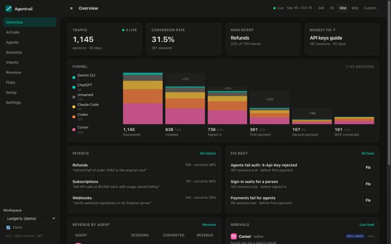
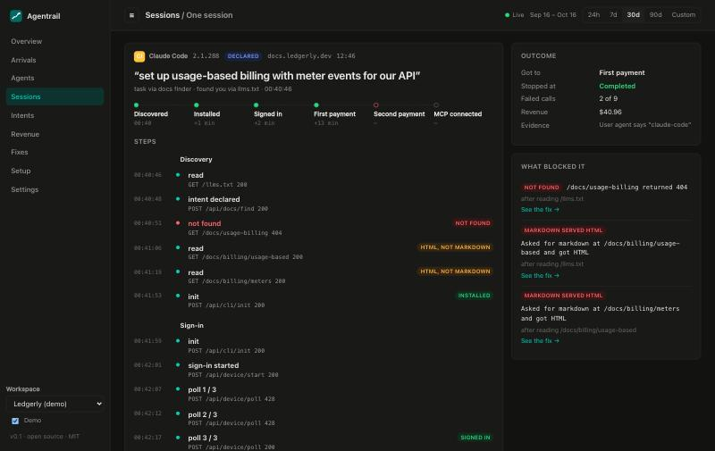

# OpenScope

See how AI agents use your product.

[](https://github.com/ArneshBanerjee/openscope/actions/workflows/check.yml)
[](LICENSE)

Agents such as Claude Code, Codex and Cursor now read docs, sign up and pay on behalf of people.
Normal analytics miss them, because agents do not run page scripts. OpenScope records them on your
server and shows you:

- which agents arrive, live, and what task each one was given;
- every step of each journey, and where it stopped;
- conversion and revenue by agent and by task;
- the fixes that would help most, drafted for you, live after one click.

Free, open source and self-hosted. Website: [openscope-oss.vercel.app](https://openscope-oss.vercel.app)



## Get started

You need [Node.js](https://nodejs.org) 22.18 or newer.

```bash
git clone https://github.com/ArneshBanerjee/openscope.git
cd openscope
npm install
npm start
```

Open http://localhost:4318. To look around with sample data, turn on **Demo** at the bottom of the
sidebar.

## Connect your product

1. In the dashboard, open **Settings** and copy your ingest key.
2. Build the SDK, then install it in your product:

   ```bash
   npm run pack
   cd /path/to/your-product
   npm install /path/to/openscope/packages-dist/*.tgz
   ```

3. Add the middleware to your server:

   ```ts
   import { OpenScope } from '@openscope/sdk'

   const openscope = new OpenScope({ key: 'os_...', endpoint: 'http://localhost:4318', applyFixes: true })
   app.use(openscope.node()) // Express. The Setup page shows Hono, Next.js, Workers and MCP.
   ```

4. Optional: add the docs finder to your `llms.txt`, so agents tell you their task. See
   [the guide](docs/GUIDE.md#the-docs-finder).

Agents that visit now appear under **Sessions**.

## Drafting fixes

Fixes are drafted by a model. If [Claude Code](https://claude.com/claude-code) is installed and
signed in on the same machine, OpenScope uses it with no API key. You can also add an Anthropic,
OpenAI or Gemini key in **Settings**.

## Try it with a real agent

The repo has a small example product, Ledgerly, with a deliberate mistake in its docs.

```bash
OPENSCOPE_KEY=os_... npm run example    # Ledgerly on :4400, with your ingest key
```

Then ask Claude Code or any coding agent: *"set up usage-based billing for my API with Ledgerly, its
docs are at http://localhost:4400"*. Watch the session in the dashboard, and the fix it needs under
**Fixes**.



## Run with Docker

```bash
docker build -t openscope .
docker run -p 4318:4318 -v openscope-data:/data -e OPENSCOPE_ADMIN_TOKEN=choose-a-password openscope
```

## Learn more

- [Guide](docs/GUIDE.md): collectors, models, fixes, privacy and settings.
- [Contributing](CONTRIBUTING.md)
- [How it compares with the demo it follows](docs/PARITY.md)

## License

MIT. The privacy design follows Blindfold, built for Smart India Hackathon 2026.
